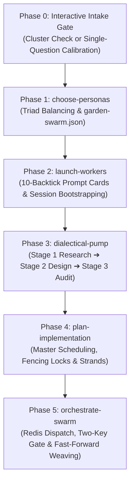

# Garden Ceremony Lifecycle Specification

> **End-to-End Multi-Agent Swarm Governance & Execution Protocol**  
> *A normative specification defining the 6 sequential phases of the Garden swarm lifecycle, quality gates, and sovereign session bootstrapping.*

---

## 1. Lifecycle Overview & Phase Sequence

Garden governs autonomous AI coding swarms through 6 sequential, deterministic phases. Phases must execute in order; skipping phases or inverting their order is strictly prohibited.



---

## 2. Phase 0: Interactive Project Intake & Swarm Calibration

### Fast-Path Check (First-Look Invariant)
Before presenting any configuration questions or prompting the operator, the Lead Orchestrator MUST execute:
```bash
rhizo who --json
```
- **If active, healthy workers exist on the cluster**:
  1. Skip swarm setup and persona quizzes entirely.
  2. Latch directly onto the existing online workers (`@worker-1`, `@worker-2`, ...).
  3. Proceed immediately to Phase 3 (Dialectical Pump / Task Breakdown) or Phase 5 (Task Dispatch).

### Cold-Start Intake Protocol (Zero Active Workers Only)
If and only if no active cluster workers exist, the session conducts a streamlined **Single-Question Intake Interview**:
- The coding harness is auto-detected from the environment (`ANTIGRAVITY_APP_DIR` $\to$ Antigravity IDE, `CLAUDE_CODE` $\to$ Claude Code CLI, `OPENCODE_SESSION_ID` $\to$ OpenCode, `CODEX_SESSION_ID` $\to$ Codex, `PI_SESSION_ID` $\to$ Pi).
- The orchestrator presents options combining swarm shape and the detected harness:
  - *Option 1 (Recommended)*: Multi-Agent Swarm: Balanced Triad in <Detected Harness> (Architect, Auditor, DevEx Lead).
  - *Option 2*: Multi-Agent Swarm: Focused Duo in <Detected Harness> (Implementer, Auditor).
  - *Option 3*: Single-Agent Inline (Execute sequentially within current chat).
  - *Option 4*: Custom Swarm (Operator specifies roles).

> [!CRITICAL]
> **Subagent & Tmux Prohibition**:
> Swarm workers are ALWAYS sovereign, independent interactive sessions (dedicated terminal tabs or IDE windows) bootstrapped via 10-backtick prompt cards. Harness-internal subagents (e.g. Antigravity's `invoke_subagent`, Claude Code's `Task`, OpenCode subtasks) are STRICTLY PROHIBITED as cluster workers. Internal subagents are ephemeral, cannot maintain persistent blocking listeners, and cause severe context poisoning.

> [!CRITICAL]
> **Session Default Models**:
> Swarm workers operate in sovereign sessions and inherit whatever foundation model is active in that window/tab. Standalone model pairing questionnaires are strictly prohibited. Prompt cards specify `Model: Session Default (active in window/tab)`.

---

## 3. Phase 1: Persona Formulation & Balancing (`choose-personas`)

Analyzes the repository context, tech stack, and task requirements to configure a balanced triad of complementary personas with opposing priorities:

1. **Systems Architect (`@<project>-architect`)**: Focuses on correctness, clean abstractions, backwards compatibility, and API stability.
2. **Adversarial Auditor (`@<project>-auditor`)**: Focuses on failure modes, race conditions, edge cases, regression risks, and security vulnerabilities.
3. **DevEx & Implementation Lead (`@<project>-implementer`)**: Focuses on implementation velocity, ergonomically simple code, test suite execution, and clean documentation.

Outputs the ratified configuration to `garden-swarm.json`.

---

## 4. Phase 2: Session Bootstrapping (`launch-workers`)

Generates distinct, copy-pasteable bootstrap prompts for each worker session:

1. Wraps each prompt card in **10 backticks** (` ``````````markdown `) to guarantee that coding harnesses render the block as clean, unrendered raw markdown.
2. Instructs the operator:
   ```text
   1. Open X terminal tabs or windows in your detected coding harness.
   2. Copy the raw block inside each 10-backtick pre block below and paste it into its corresponding session.
   3. Once pasted, tell me here (or I will automatically detect them online via rhizo who).
   ```
3. Arms the orchestrator presence (`rhizo open <project>-orchestrator`).
4. Verifies cluster heartbeat readiness via `rhizo who --json` before proceeding.

---

## 5. Phase 3: Empirical Dialectical Pump (`dialectical-pump`)

Drives multi-perspective deliberation across workers. Roleplay without empirical tool grounding is strictly prohibited:

- **Stage 1: Grounded Research & Understanding**: Workers read code, ASTs, and git history to produce `docs/research_and_understanding.md`. Verified by an automated Fact-Check Gate (`docs/fact_check_report.md`).
- **Stage 2: Product & System Architecture Design**: The Architect drafts `docs/design.md`.
- **Stage 3: Adversarial Design Review & Audit**: The Auditor stress-tests the design, identifies gaps, and produces `docs/audit_report.md`. Any discrepancies require formal resolution before proceeding.

---

## 6. Phase 4: Ceremonial Master Implementation Planning (`plan-implementation`)

Authors `implementation_plan.md` mapping:
1. Exact task distribution across personas.
2. Distributed locking schedules via Rhizo monotonic fencing tokens.
3. Workspace virtualization via Vine APFS Copy-on-Write strands.
4. Dynamic markdown task checklists synchronized with native coding harness To-Do tracking.
5. Emergent Design Addendum Protocol (`addendum_<topic>.md`).

---

## 7. Phase 5: Live Conductor & Swarm Orchestration (`orchestrate-swarm`)

The Lead Orchestrator governs execution:
- Dispatches tasks over the Rhizo Redis bus (`rhizo send`, `rhizo enqueue`).
- Workers autonomously claim tasks, provision isolated Vine strands (`vine new <id>`), and implement code.
- Workers verify changes against the Two-Key Gate (`vine gate`).
- Lead Orchestrator executes fast-forward trunk merges (`vine weave`) and acknowledges tasks (`rhizo ack`).
- Lead Orchestrator arms its background listener at the end of every turn to await worker gate reports.
