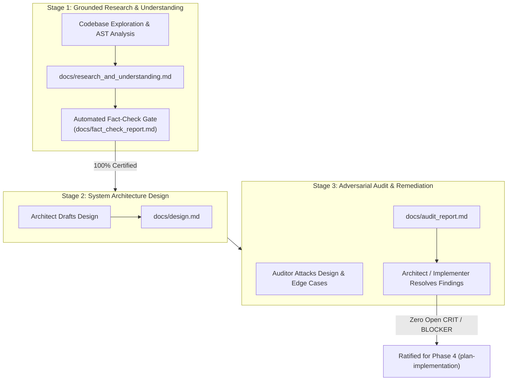

# Garden Dialectical Pump Protocol

> **Empirical Triadic Deliberation & Adversarial Synthesis**  
> *A normative methodology for multi-perspective agent deliberations grounded strictly in tool execution, empirical citations, and formal audit remediation.*

---

## 1. Core Epistemic Invariant: Zero Theatrical Dialogue

Garden rejects passive conversational roleplay. Multi-agent debate is not a theatrical performance:

<CRITICAL>
Zero Theatrical Dialogue Invariant:
Every statement, critique, or assertion made by an agent during the Dialectical Pump MUST be grounded in empirical evidence obtained via tool calls:
- Exact file paths and line ranges (`file:///path/to/file#L10-L25`)
- Compiler error output or type-checker diagnostics
- Test suite logs and reproduction traces
- AST structural analysis or benchmark numbers
- Git history and merge-base diffs
Unsubstantiated conversational affirmations ("I agree!", "That sounds like a great architecture!") without empirical citations are strictly prohibited.
</CRITICAL>

---

## 2. The 3 Sequential Dialectical Stages

---

## 3. Stage 1: Grounded Research & Fact-Check Gate

1. **Empirical Exploration**:
   Workers inspect existing code, benchmark latencies, inspect API contracts, and trace call graphs using read and command tools.
2. **Authoring `docs/research_and_understanding.md`**:
   Documents empirical reality: existing invariants, performance baselines, dependency graphs, and historical constraints.
3. **Automated Fact-Check Gate**:
   An independent auditor verifies every factual claim in the document against live repository code and local hardware:
   - Claims certified: Confirmed via tool execution.
   - Claims falsified: Immediate rejection; document returned for revision.
   - Outputs: `docs/fact_check_report.md`.

---

## 4. Stage 2: Product & System Architecture Design

1. **Authoring `docs/design.md`**:
   The Systems Architect authors the canonical technical design document:
   - System component diagrams and data flow.
   - Data models, Redis keyspaces, and wire protocols.
   - Formal invariants and error handling state machines.
   - Public API contracts and CLI subcommand semantics.
   - Migration strategy and zero-breaking-change guarantees.

---

## 5. Stage 3: Adversarial Design Review & Audit Remediation

1. **Adversarial Audit**:
   The Adversarial Auditor conducts a rigorous attack on `docs/design.md`:
   - Race conditions, concurrent writes, and split-brain scenarios.
   - Deadlocks and lease starvation.
   - Memory RSS leaks and unbounded resource exhaustion.
   - Unhandled error cases and network partition behavior.
2. **Authoring `docs/audit_report.md`**:
   Categorizes findings by severity:
   - `CRITICAL`: System-breaking defect, memory corruption, or race condition. Blocks implementation.
   - `HIGH`: Major specification gap or unhandled failure mode. Blocks implementation.
   - `MEDIUM`: Suboptimal performance or incomplete edge-case handling.
   - `LOW` / `NIT`: Stylistic improvement or minor clarity issue.
3. **Remediation & Ratification**:
   The Architect and Implementer resolve all `CRITICAL` and `HIGH` findings directly in `docs/design.md`. Once zero blocking defects remain, the design is officially **ratified**.

---

## 6. The Emergent Design Addendum Protocol

During implementation (Phase 5), workers may uncover unexpected hardware constraints or third-party library limitations that require architectural adjustments:

<INVARIANT>
Emergent Design Addendum Protocol:
Workers discovering architectural discrepancies are strictly forbidden from unilaterally altering 'docs/design.md' or deviating silently from the plan.
Instead, they MUST:
1. Author 'docs/addenda/addendum_<topic>.md' detailing the empirical finding, alternative options, and recommended resolution.
2. Dispatch the addendum to the Lead Orchestrator for ratification.
3. Upon ratification, update 'docs/design.md' and refresh 'implementation_plan.md'.
</INVARIANT>
