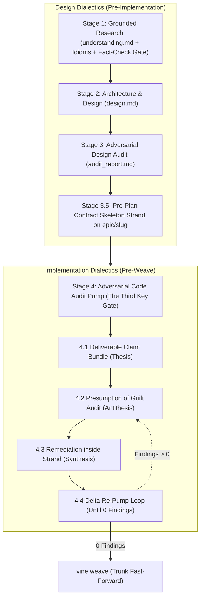
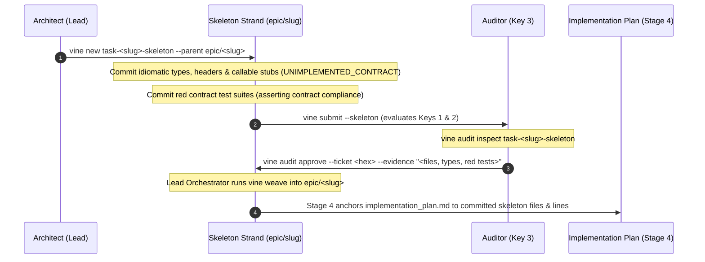
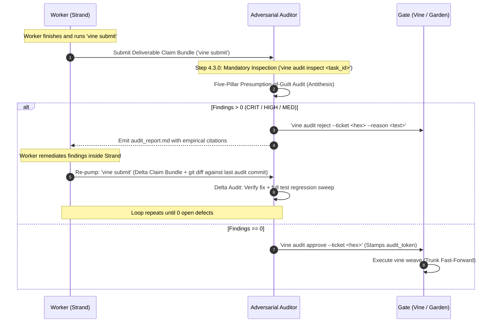

# `dialectical-pump`: Grounded Multi-Persona Deliberation Engine

> **Thesis $\times$ Antithesis $\to$ Empirical Synthesis**  
> *The Dialectical Pump is an epistemic machine. It prevents hallucinated consensus, superficial approximations, and green mirages by forcing opposing personas to prove every assertion through real tool execution.*

---

## 1. The Core Invariant: Zero Theatrical Dialogue

> [!CAUTION] **STRICT PROHIBITION: Theatrical Dialogue is Rejected**
> A common failure mode in LLM roleplay is generating conversational chit-chat:  
> *"Persona A: I think we should use Redis! Persona B: I agree, but what about memory? Persona A: Good point!"*  
> **This is banned.**

Every turn taken by a persona in the Dialectical Pump must follow the **Empirical Grounding Protocol**:
1. **Tool Invocation**: Every claim must be substantiated by a tool call:
   - Reading exact line numbers: `view_file(AbsolutePath=..., StartLine=..., EndLine=...)`.
   - Running test suites: `run_command(CommandLine="pytest ...")`.
   - Measuring execution or memory: `run_command(CommandLine="time ...")`.
   - Checking git history/diffs: `run_command(CommandLine="git log -S ...")`.
2. **Hard Evidence Citations**: Every critique must cite verifiable evidence:
   - *Prohibited*: "This function looks inefficient."
   - *Mandated*: "Profiling `parsePayload` at `src/resp.nim:88` reveals an allocation of a 64KB temporary string per message; under 10k messages/sec, this triggers 640MB/sec of GC churn as verified by `nimble bench`."

---

## 2. The Dialectical Stages & Contract Skeleton Ceremony

The Dialectical Pump executes across five distinct project gates adhering to Option B (`RFD -> RFC -> Contract Skeleton Strand on epic/<slug> -> Implementation Plan -> Parallel Strands`):



---

## 3. Stage 1: Grounded Research & Fact-Check Gate

### Step 1.1: Research Plan Formulation
The triadic personas inspect the assignment and agree on the empirical questions:
- What are the existing invariants in the codebase?
- What dependencies and protocols exist?
- What test suites cover this subsystem?

### Step 1.2: Codebase Exploration
Workers read actual files, verify test suites, and map domain structures.

### Step 1.3: Generate Understanding Document (`understanding.md`)
The triad synthesizes their findings into `understanding.md` containing:
- Domain Glossary & Invariants.
- **Existing Codebase Idioms, Type Conventions & Test Patterns**:
  - *Naming Conventions*: Module, type, procedure/function, and variable casing conventions (e.g. `camelCase` procs vs `PascalCase` types in Nim; `snake_case` in Python/Rust; private symbol prefixes).
  - *Error-Handling Styles*: Result types (`Result[T, E]`), optional types (`Option[T]`), error return codes, or language-specific exception hierarchies.
  - *Header, Type & Module Layout*: How public types, constants, interfaces, and exported symbols are structured across files.
  - *Test Harness & Assertion Patterns*: Test runner conventions (`unittest`, `tripwire`, `pytest-tripwire`), golden file strategies, and negative control idioms.
- Data Flow Diagrams.
- Identified Constraints & Technical Debt.

### Step 1.4: The Strict Fact-Check Gate
Before proceeding to design, a dedicated Auditor persona audits `understanding.md`:
- Every file reference must exist (`test -f <path>`).
- Every function signature cited must match reality.
- If any claim is ungrounded or fabricated, the pump repeats Step 1.2 until 100% verified.

---

## 4. Stage 2: Architecture & System Design (`design.md`)

Once research is fact-checked, the pump shifts to product and technical design:

### Step 2.1: The Thesis (Systems Architect)
The Systems Architect proposes the macro architecture:
- Module decomposition adhering to discovered codebase idioms.
- Data structures and wire formats.
- Concurrency model and lifecycle states.

### Step 2.2: The Antithesis (Purist Auditor)
The Purist Auditor stress-tests the proposal against concrete failure modes:
- Concurrency race conditions: "What happens if process A dies between lines X and Y?"
- Resource leaks: "Where are file descriptors closed during exception unwinding?"
- Backwards compatibility: "Does this break existing configs or CLI arguments?"

### Step 2.3: The Synthesis (DevEx & Implementation Lead)
The DevEx Lead resolves the dialectic:
- Eliminates unnecessary abstractions that create ergonomics drag.
- Hardens the API contracts: specifies exact public types, headers/interfaces, exported procedure/function signatures, and contract test cases adhering to discovered idioms.
- Produces the ratified **`design.md`**.

---

## 5. Stage 3: Adversarial Review & Audit Report

### Step 3.1: Forensic Audit Inspection
An Auditor persona performs a line-by-line inspection of `design.md` against single-source truth and ISO standards, generating **`audit_report.md`**:
- Defect codes: `CRIT-01`, `WARN-02`, `DOC-03`.
- Root cause analysis.
- Specific non-prescriptive recommendation options.

### Step 3.2: Remediation & Resolution
The triad meets to address every finding in `audit_report.md`:
- For each defect code: select an option, update `design.md`, and record the resolution in the audit report.
- The gate only clears when **0 critical or blocker defects remain open**.

---

## 5.5. Stage 3.5: Pre-Plan Contract Skeleton Strand on `epic/<slug>`

Before authoring `implementation_plan.md` and dispatching parallel workers, the Triad commits the idiomatic public contracts, callable stubs, and red contract tests onto the feature integration branch `epic/<slug>`:



### Step 3.5.1: Provision the Skeleton Strand
```bash
vine new task-<slug>-skeleton --parent epic/<slug>
```
*Creates the feature integration branch `epic/<slug>` if not already present, isolating foundational contracts from canonical `main`.*

### Step 3.5.2: Commit Idiomatic Contracts & Red Stubs
Inside the strand, the Architect implements:
1. **Public Types & Interfaces**: Concrete types, enums, structs/objects matching the discovered idioms from Stage 1 and Stage 2.
2. **Exported Callable Stubs**: Exported procedures/functions that compile cleanly but return an explicit `UNIMPLEMENTED_CONTRACT` defect or error code (or throw a structured `NotImplementedDefect` / exception).
3. **Red Contract Test Suites**: Rigorous contract tests that call the exported stubs. Under test execution, these tests must run and fail deterministically with `UNIMPLEMENTED_CONTRACT` (proving that tests genuinely invoke the contract and do not pass vacuously).

### Step 3.5.3: Submit and Audit the Skeleton Strand
- The worker executes `vine submit --skeleton` (evaluating Key 1 merge-tree and Key 2 compilation/contract tests).
- The Adversarial Auditor runs `vine audit inspect task-<slug>-skeleton` to forensic-check type signatures and error semantics against `design.md`.
- Upon verification, the auditor ratifies Key 3 (evidence-bound approval without weaving):
  ```bash
  vine audit approve task-<slug>-skeleton --auditor <auditor_name> --ticket <hex> --evidence "Committed idiomatic types in src/types.nim, stubs in src/api.nim, and red contract tests in tests/test_contract.nim" --listen
  ```
- The Lead Orchestrator then weaves the verified skeleton into `epic/<slug>`:
  ```bash
  vine weave
  ```

Proceed to [`plan-implementation`](../plan-implementation/SKILL.md) to author `implementation_plan.md` anchored to the committed skeleton symbols, and spawn parallel worker strands branching off `--parent epic/<slug>`.

---

## 6. Stage 4: Pre-Weave Adversarial Code Audit Pump (The Third Key Gate)

Before any strand is woven into canonical trunk (`vine weave`), it must pass the **Adversarial Code Audit Pump**. Passing Key 1 (mechanical merge-tree) and Key 2 (semantic test runner) is necessary but insufficient: tests may be green mirages, and code may be disconnected shelfware or heuristic hand-waves.

<CRITICAL>
The Presumption-of-Guilt Invariant:
The Adversarial Auditor approaches every deliverable with the active operational presumption that the code IS disconnected shelfware, IS a half-baked heuristic hand-wave, DOES contain hollow mocks, DOES rely on loose partial assertions, and FAILS true fidelity until mathematically and empirically disproven through tool execution.
</CRITICAL>

### Step 4.1: Assembling the Thesis (The Deliverable Claim Bundle)

The Thesis in a code review is neither a raw dump of files nor vague conversational prose. The implementer must formulate a structured **Deliverable Claim Bundle**:

```markdown
# DELIVERABLE CLAIM BUNDLE (Thesis)
- Task ID: <task-id>
- Strand Path: <strand-path>
- Base Commit: origin/main (<sha>)

## 1. Contract & Deliverables
- Target Deliverables: List of files created/modified
- Operator Directive: Exact prompt requirements & references

## 2. Closed-Circuit Two-Point Diff
- Provider: Primary new logic / capability modules
- Consumer Call-Sites: Live production callers (CLI parser, HTTP router, UI canvas, event loop)
- Replacement Purge: Explicit list of obsolete files, functions, or fallbacks deleted in this diff

## 3. Test Evidence & Assertion Rigor
- Test Suite Executed: Exact command and execution time
- Assertion Style: Complete structural equality (`assert actual == expected`) or tripwire snapshots
- Negative Controls: List of tests asserting failure under invalid/adversarial inputs

## 4. Changelog & Release Discipline
- Changelog Target: Path to changelog (`CHANGELOG.md`) or explicitly marked bypass (`--allow-no-changelog`)
- Unreleased Entry: Exact entry recorded under `## [Unreleased]` via `vine changelog`
```

### Step 4.2: The Five-Pillar Forensic Code Audit (Antithesis)

The Auditor executes the following checks against the Claim Bundle and the strand diff (`git diff origin/main...HEAD`):

#### Pillar 0: Changelog Gate & Release Discipline
- [ ] **Changelog Updated**: If the project contains a changelog (`CHANGELOG.md`, `changelog.md`, etc.), verify that the strand diff modifies it under `## [Unreleased]`.
- [ ] **No Unreleased Section Missing**: Verify that `## [Unreleased]` exists (scaffolded via `vine changelog --ensure-unreleased` if needed).
- [ ] **Exit Code 5 Clearance**: Confirm `vine gate` passed without `GATE_CHANGELOG_VIOLATION` (or `--allow-no-changelog` was explicitly justified).

#### Pillar 1: Disconnected Shelfware & Closed-Circuit Consumer Audit
- [ ] **Live Consumer Call-Site Verification**: Does the new capability plug directly into the production entrypoint, router, CLI dispatcher, or UI?
- [ ] **Import Audit**: Is the provider module imported and exercised outside of its own unit test files?
- [ ] **Hermetic Shelfware Rejection**: Code tested only by its own unit tests is rejected back to the worker as incomplete shelfware (unless explicitly contracted as `[STAGED - NOT WIRED]` in `implementation_plan.md`).

#### Pillar 2: Holistic Integration vs. Heuristic Hand-Waves & Hollow Stubs
- [ ] **Anti-Stub & Anti-Toy Check**: Does the implementation handle real application state, real network/file I/O, and real concurrent events?
- [ ] **No Hollow Mocks in Production**: Reject artificial `sleep()` calls, hardcoded success responses, or fake test doubles in production paths.
- [ ] **Absolute Ban on Silent Mock Fallbacks (`BLOCKER: MISSING_DEPENDENCY`)**: Strictly prohibit inventing silent mock fallbacks (e.g. `lesMockFallback`, synthetic mock questionnaires, or dummy stub responses) when an external dependency, hardware target, API key, or neural model is unavailable. If a dependency cannot be satisfied, the worker MUST immediately halt execution and emit a formal blocker (`BLOCKER: MISSING_DEPENDENCY`). Sweeping missing dependencies under the rug with silent fake mocks is grounds for immediate audit rejection (`CRIT-MOCK-FALLBACK`).
- [ ] **Anti-Defeat-Device & Anti-Theatrical Interceptor Mandate**: Strictly reject prompt keyword interceptors (e.g. `if 'flight game' in q or 'webworker' in q`) and theatrical mock questionnaires in generic runtimes that bypass genuine neural/radar/algorithmic pipelines to fake benchmark compliance. This is a critical `CRIT-DEFEAT-DEVICE` defect requiring complete elimination.
- [ ] **Autonomous Intensive Audit Mandate**: Intensive audits are Standard Operating Procedure (SOP) and pre-authorized. Auditors must execute without requesting operator confirmation or input.
- [ ] **Brittle String-Split Hacks**: Reject naive string splits (`str.split(" ")[0]`) pretending to parse structured protocols or payloads; compliant lexers/parsers must be used.
- [ ] **Swallowed Exceptions**: Reject empty `except: pass` or `catch: discard` blocks that sweep real error conditions under the rug.

#### Pillar 3: Literal Fidelity & Reference Parity Mandate (Anti-Approximation)
<CRITICAL>
Literal Fidelity & True-Fidelity Mandate:
When a deliverable is recreating, porting, reverse-engineering, duplicating functionality from an existing reference, or executing an operator directive where fidelity is expected:
1. Anti-Approximation Rule: "Approximate", "looks right", "heuristic shortcut", "gist-level", or "good enough for happy paths" implementations are STRICTLY REJECTED.
2. Literal Specification Adherence: The implementation must be literally and precisely the thing that was asked for. The auditor must verify compliance against every specified edge case, type boundary, flag interaction, return semantic, and error flow of the original reference or operator prompt.
3. Zero Corner-Cutting: Tedious, difficult, or complex cases cannot be hand-waved away or substituted with shallow shortcuts.
4. Empirical Parity Testing: Wherever a reference implementation or specification exists, the audit requires characterization tests, golden file outputs, or structural round-trip comparisons proving exact functional parity.
</CRITICAL>

#### Pillar 4: Aggressive Replacement Purge (Zero Dead-Code Carcasses)
- [ ] **Zero Vestigial Fallbacks**: Any existing code, configurations, or legacy paths meant to be upgraded or superseded by this feature MUST be deleted in the same strand.
- [ ] **No Zombie Shims**: Commented-out legacy code, dead helper functions, or deprecated fallback branches are strictly prohibited.

#### Pillar 5: Green Mirage Elimination & Structural Assertion Rigor
<CRITICAL>
Assertion Rigor & Anti-Green-Mirage Mandate:
1. Complete Object Equality: Partial or loose assertions ("loosey goosey" tests) are strictly forbidden:
   - ❌ FORBIDDEN: `assert "foo" in response`
   - ❌ FORBIDDEN: `assert len(result) > 0`
   - ❌ FORBIDDEN: `assert obj.status == "ok"` (ignoring payload fields)
   - ✅ MANDATED: `assert actual == expected` comparing the complete expected parent object, schema, or full deterministic string.
2. Structural Snapshotting: Prefer Nim's `tripwire` library or Python's `pytest-tripwire` to assert complete structural integrity without brittle manual mocks.
3. Mandatory Negative Controls: Tests must explicitly assert that invalid inputs, expired leases, missing files, or corrupted data fail deterministically with expected error codes.
4. Zero Happy-Path-Only Testing: Boundary values (empty, 0, 1, max, unicode, timeout, disconnection) must be explicitly exercised.
</CRITICAL>

#### Contract Immutability & Anti-Drift Invariant
<CRITICAL>
Contract Immutability on Feature Integration Branches (`epic/<slug>`):
When parallel implementation strands branch off `--parent epic/<slug>` following the Stage 3.5 Skeleton Ceremony:
1. Exported Contract Immutability: Workers MUST NOT alter exported type declarations, procedure/function signatures, error types, or CLI options established in the committed contract skeleton. If an implementation constraint requires modifying an exported signature, the worker MUST NOT unilaterally drift code; it MUST draft a formal `docs/addenda/addendum_<topic>.md` and await Orchestrator ratification.
2. Contract Test Protection: Workers MUST NOT weaken, disable, comment out, or delete contract tests committed during Stage 3.5. Contract tests define the acceptance criteria; all tests must turn from red to green under genuine production logic.
3. Anti-Mock-Fallback: If an external dependency or hardware environment cannot be satisfied, workers MUST NOT invent fake fallbacks (e.g. `lesMockFallback`); they MUST halt and report `BLOCKER: MISSING_DEPENDENCY`.
</CRITICAL>

### Step 4.3: The Delta Re-Pump Loop (Iterative until Zero Findings)

A single review pass is never sufficient. The Adversarial Code Audit executes as an **iterative dialectical pump**:



> [!CRITICAL]
> **THE WORKER IS NOT THE AUDITOR**: Workers cannot audit or approve their own strands (`vine audit approve` strictly enforces `auditor != author`). The audit MUST be performed by an independent Adversarial Auditor session.

#### Key 3 Auditor Discipline, Single-Strand Isolation & Forensic Standards

<CRITICAL>
Auditor Merge-Clerk Decoupling Invariant:
The Adversarial Auditor ONLY inspects and ratifies/rejects Key 3 (`vine audit inspect` + `vine audit approve/reject`). The Lead Orchestrator is solely responsible for running `vine weave` after Key 3 ratification. The Orchestrator is strictly forbidden from delegating weaving (`--weave`), merge conflict resolution, `ROADMAP.md` updates, or release chores to the Adversarial Auditor. Turning the Auditor into a merge clerk biases the LLM toward rubber-stamping audits just to finish its administrative checklist.
</CRITICAL>

<CRITICAL>
Single-Strand Audit Isolation (Anti-Batching Invariant):
Orchestrators MUST dispatch at most ONE strand per Key 3 audit request. Batching multiple strands into a single audit message (e.g. "Audit tasks 3.1, 3.2, 3.3, 3.5") collapses LLM attention, blinds the auditor to edge cases, and causes rubber-stamping. Every strand must be audited independently in its own focused turn.
</CRITICAL>

<CRITICAL>
Inverted Approval vs Rejection Effort Gradient (`--evidence` Mandate):
Rejection is the low-friction fast path whenever ANY doubt, defect, green mirage, or missing negative control exists:
`vine audit reject <task_id> --auditor <name> --ticket <hex> --reason "<findings>" --listen`

Approval is intentionally high-friction and evidence-bound. Running `vine audit approve` strictly requires `--evidence "..."` citing specific changed file basenames, provider->consumer call-sites, and negative control assertions from the diff:
`vine audit approve <task_id> --auditor <name> --ticket <hex> --evidence "<changed files, provider->consumer call-sites, negative controls>" --listen`
Passing vague praise or empty justifications without empirical diff citations is mechanically and procedurally rejected.

> [!NOTE]
> **Multiplexed Router vs CLI Subprocesses**: In CLI subprocess harnesses (Claude Code, Codex), `--listen` re-arms the single-shot listener upon delivering the audit decision. In Multiplexed Router harnesses (Google Antigravity, OpenCode, Pi), the session is continuously connected to the host router, so per-turn listener re-arming is not required.
</CRITICAL>

1. **Mandatory Inspection (`vine audit inspect <task_id>`)**: Before issuing any audit decision (`approve` or `reject`), the Auditor MUST execute `vine audit inspect <task_id>` to inspect the deliverable claim bundle, delivery ticket, strand git diff, and test evidence. Approving an audit blindly without inspection is strictly prohibited.
2. **Strict Prohibition on `--force` on Approvals**: Auditors MUST NEVER pass `--force` to bypass failing tests, uncommitted dirty files, or mismatched delivery tickets. If verification fails, the auditor MUST reject (`vine audit reject`) back to the worker.
3. **Auditors Are NOT Release or Merge Clerks**: Auditors are adversarial verifiers of code correctness, NOT administrative clerks.
   - Auditors MUST NEVER edit `ROADMAP.md` or update roadmap statuses on behalf of workers.
   - Auditors MUST NEVER resolve `CHANGELOG.md` or code merge conflicts on behalf of workers.
   - If a strand has merge conflicts or a missing/conflicted changelog entry, the Auditor rejects the deliverable with a defect code (`REJECT: MERGE_CONFLICT` or `REJECT: CHANGELOG_VIOLATION`); the worker must resolve it cleanly inside the strand.
4. **Defect Issuance**: If defects are discovered, the Auditor runs `vine audit reject <task_id> --auditor <auditor_name> --ticket <hex> --reason "<defects>" --listen` and records findings in `audit_report.md` with defect codes (`CRIT-XX`, `HIGH-XX`, `FIDELITY-XX`, `MIRAGE-XX`), exact file lines, and failure proof.
5. **In-Strand Remediation**: The worker fixes findings strictly inside the isolated Vine strand.
6. **The Delta Re-Pump**: When resubmitting with `vine submit` (which generates a refreshed delivery ticket), the auditor audits the **exact delta** (`git diff <audit_commit>...HEAD`) to ensure fixes do not introduce secondary defects, while re-running the full project test suite (`vine gate`) to guarantee no regressions.
7. **Exit Condition**: The pump loops until **ZERO open defects of severity CRIT, HIGH, or MED remain**, and all low/nit items are resolved or empirically justified.

### Step 4.4: Gate Clearance & Cryptographic Token

When all findings reach 0, the independent auditor ratifies Key 3 (evidence-bound approval, with `--weave` removed):
```bash
# 1. Mandatory inspection
vine audit inspect <task_id>

# 2. Ratify Key 3 with empirical evidence citations (Auditor NEVER runs --weave):
vine audit approve <task_id> --auditor <auditor_name> --ticket <hex> --evidence "Provider in src/provider.nim, Consumer in src/consumer.nim:42, negative control in tests/test_cases.nim:88" --listen
```
This mechanically verifies Keys 1 & 2 against the delivery ticket, checks that the strand has zero uncommitted changes, ensures `auditor != author`, verifies that `--evidence` is provided, and stamps a cryptographic `audit_token`. Vine stores strand identity in `.git/config` (`vine.taskId`, `vine.project`) and authoritative state in Redis (zero on-disk state files).

Only strands in `AUDIT_RATIFIED` state with a valid cryptographic audit token are permitted to weave into trunk. **The Lead Orchestrator then executes trunk weaving**:
```bash
# Executed by Lead Orchestrator upon receiving Key 3 ratification:
vine weave
```
*(This automatically invokes `rhizo task complete` and promotes downstream DAG child tasks from `BLOCKED` to `QUEUED`).*

---

## 7. Output Artifacts

At the conclusion of the Dialectical Pump:
1. `understanding.md` (Stage 1: Grounded, idioms extracted, and fact-checked).
2. `design.md` (Stage 2: Debated, hardened, and synthesized with idiomatic types & interfaces).
3. `design_audit_report.md` (Stage 3: Design findings addressed and closed).
4. **Committed Contract Skeleton & Red Tests on `epic/<slug>`** (Stage 3.5: Public types, callable stubs with `UNIMPLEMENTED_CONTRACT`, and red contract test suites).
5. `code_audit_report.md` (Stage 4: Pre-weave Five-Pillar audit cleared with 0 open defects under Contract Immutability).

Proceed to [`orchestrate-swarm`](../orchestrate-swarm/SKILL.md) for trunk weaving.
