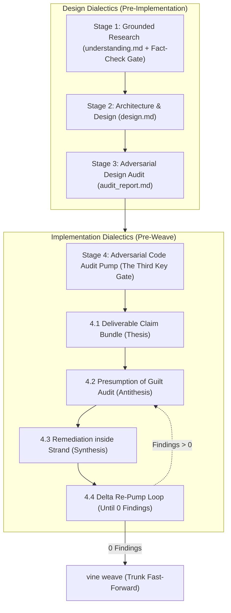
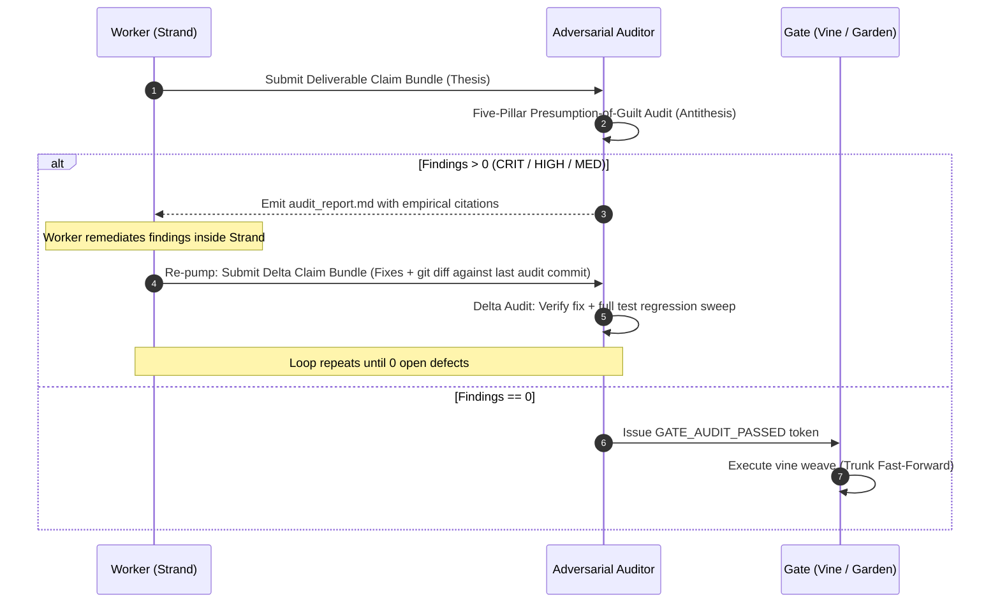

# `dialectical-pump`: Grounded Multi-Persona Deliberation Engine

> **Thesis $\times$ Antithesis $\to$ Empirical Synthesis**  
> *The Dialectical Pump is an epistemic machine. It prevents hallucinated consensus, superficial approximations, and green mirages by forcing opposing personas to prove every assertion through real tool execution.*

---

## 1. The Core Invariant: Zero Theatrical Dialogue

> [!CAUTION] **STRICT PROHIBITION: Theatrical Dialogue is Rejected**
> A common failure mode in LLM roleplay is generating conversational chit-chat:  
> *"Persona A: I think we should use Redis! Persona B: I agree, but what about memory? Persona A: Good point!"*  
> **This is banned.**

Every turn taken by a persona in the Dialectical Pump must follow the **Empirical Grounding Protocol**:
1. **Tool Invocation**: Every claim must be substantiated by a tool call:
   - Reading exact line numbers: `view_file(AbsolutePath=..., StartLine=..., EndLine=...)`.
   - Running test suites: `run_command(CommandLine="pytest ...")`.
   - Measuring execution or memory: `run_command(CommandLine="time ...")`.
   - Checking git history/diffs: `run_command(CommandLine="git log -S ...")`.
2. **Hard Evidence Citations**: Every critique must cite verifiable evidence:
   - *Prohibited*: "This function looks inefficient."
   - *Mandated*: "Profiling `parsePayload` at `src/resp.nim:88` reveals an allocation of a 64KB temporary string per message; under 10k messages/sec, this triggers 640MB/sec of GC churn as verified by `nimble bench`."

---

## 2. The Four Dialectical Stages

The Dialectical Pump executes across four distinct project gates:



---

## 3. Stage 1: Grounded Research & Fact-Check Gate

### Step 1.1: Research Plan Formulation
The triadic personas inspect the assignment and agree on the empirical questions:
- What are the existing invariants in the codebase?
- What dependencies and protocols exist?
- What test suites cover this subsystem?

### Step 1.2: Codebase Exploration
Workers read actual files, verify test suites, and map domain structures.

### Step 1.3: Generate Understanding Document (`understanding.md`)
The triad synthesizes their findings into `understanding.md` containing:
- Domain Glossary & Invariants.
- Data Flow Diagrams.
- Identified Constraints & Technical Debt.

### Step 1.4: The Strict Fact-Check Gate
Before proceeding to design, a dedicated Auditor persona audits `understanding.md`:
- Every file reference must exist (`test -f <path>`).
- Every function signature cited must match reality.
- If any claim is ungrounded or fabricated, the pump repeats Step 1.2 until 100% verified.

---

## 4. Stage 2: Architecture & System Design (`design.md`)

Once research is fact-checked, the pump shifts to product and technical design:

### Step 2.1: The Thesis (Systems Architect)
The Systems Architect proposes the macro architecture:
- Module decomposition.
- Data structures and wire formats.
- Concurrency model and lifecycle states.

### Step 2.2: The Antithesis (Purist Auditor)
The Purist Auditor stress-tests the proposal against concrete failure modes:
- Concurrency race conditions: "What happens if process A dies between lines X and Y?"
- Resource leaks: "Where are file descriptors closed during exception unwinding?"
- Backwards compatibility: "Does this break existing configs or CLI arguments?"

### Step 2.3: The Synthesis (DevEx & Implementation Lead)
The DevEx Lead resolves the dialectic:
- Eliminates unnecessary abstractions that create ergonomics drag.
- Hardens the API contracts.
- Produces the ratified **`design.md`**.

---

## 5. Stage 3: Adversarial Review & Audit Report

### Step 3.1: Forensic Audit Inspection
An Auditor persona performs a line-by-line inspection of `design.md` against single-source truth and ISO standards, generating **`audit_report.md`**:
- Defect codes: `CRIT-01`, `WARN-02`, `DOC-03`.
- Root cause analysis.
- Specific non-prescriptive recommendation options.

### Step 3.2: Remediation & Resolution
The triad meets to address every finding in `audit_report.md`:
- For each defect code: select an option, update `design.md`, and record the resolution in the audit report.
- The gate only clears when **0 critical or blocker defects remain open**.

---

## 6. Stage 4: Pre-Weave Adversarial Code Audit Pump (The Third Key Gate)

Before any strand is woven into canonical trunk (`vine weave`), it must pass the **Adversarial Code Audit Pump**. Passing Key 1 (mechanical merge-tree) and Key 2 (semantic test runner) is necessary but insufficient: tests may be green mirages, and code may be disconnected shelfware or heuristic hand-waves.

<CRITICAL>
The Presumption-of-Guilt Invariant:
The Adversarial Auditor approaches every deliverable with the active operational presumption that the code IS disconnected shelfware, IS a half-baked heuristic hand-wave, DOES contain hollow mocks, DOES rely on loose partial assertions, and FAILS true fidelity until mathematically and empirically disproven through tool execution.
</CRITICAL>

### Step 4.1: Assembling the Thesis (The Deliverable Claim Bundle)

The Thesis in a code review is neither a raw dump of files nor vague conversational prose. The implementer must formulate a structured **Deliverable Claim Bundle**:

```markdown
# DELIVERABLE CLAIM BUNDLE (Thesis)
- Task ID: <task-id>
- Strand Path: <strand-path>
- Base Commit: origin/main (<sha>)

## 1. Contract & Deliverables
- Target Deliverables: List of files created/modified
- Operator Directive: Exact prompt requirements & references

## 2. Closed-Circuit Two-Point Diff
- Provider: Primary new logic / capability modules
- Consumer Call-Sites: Live production callers (CLI parser, HTTP router, UI canvas, event loop)
- Replacement Purge: Explicit list of obsolete files, functions, or fallbacks deleted in this diff

## 3. Test Evidence & Assertion Rigor
- Test Suite Executed: Exact command and execution time
- Assertion Style: Complete structural equality (`assert actual == expected`) or tripwire snapshots
- Negative Controls: List of tests asserting failure under invalid/adversarial inputs

## 4. Changelog & Release Discipline
- Changelog Target: Path to changelog (`CHANGELOG.md`) or explicitly marked bypass (`--allow-no-changelog`)
- Unreleased Entry: Exact entry recorded under `## [Unreleased]` via `vine changelog`
```

### Step 4.2: The Five-Pillar Forensic Code Audit (Antithesis)

The Auditor executes the following checks against the Claim Bundle and the strand diff (`git diff origin/main...HEAD`):

#### Pillar 0: Changelog Gate & Release Discipline
- [ ] **Changelog Updated**: If the project contains a changelog (`CHANGELOG.md`, `changelog.md`, etc.), verify that the strand diff modifies it under `## [Unreleased]`.
- [ ] **No Unreleased Section Missing**: Verify that `## [Unreleased]` exists (scaffolded via `vine changelog --ensure-unreleased` if needed).
- [ ] **Exit Code 5 Clearance**: Confirm `vine gate` passed without `GATE_CHANGELOG_VIOLATION` (or `--allow-no-changelog` was explicitly justified).

#### Pillar 1: Disconnected Shelfware & Closed-Circuit Consumer Audit
- [ ] **Live Consumer Call-Site Verification**: Does the new capability plug directly into the production entrypoint, router, CLI dispatcher, or UI?
- [ ] **Import Audit**: Is the provider module imported and exercised outside of its own unit test files?
- [ ] **Hermetic Shelfware Rejection**: Code tested only by its own unit tests is rejected back to the worker as incomplete shelfware (unless explicitly contracted as `[STAGED - NOT WIRED]` in `implementation_plan.md`).

#### Pillar 2: Holistic Integration vs. Heuristic Hand-Waves & Hollow Stubs
- [ ] **Anti-Stub & Anti-Toy Check**: Does the implementation handle real application state, real network/file I/O, and real concurrent events?
- [ ] **No Hollow Mocks in Production**: Reject artificial `sleep()` calls, hardcoded success responses, or fake test doubles in production paths.
- [ ] **Brittle String-Split Hacks**: Reject naive string splits (`str.split(" ")[0]`) pretending to parse structured protocols or payloads; compliant lexers/parsers must be used.
- [ ] **Swallowed Exceptions**: Reject empty `except: pass` or `catch: discard` blocks that sweep real error conditions under the rug.

#### Pillar 3: Literal Fidelity & Reference Parity Mandate (Anti-Approximation)
<CRITICAL>
Literal Fidelity & True-Fidelity Mandate:
When a deliverable is recreating, porting, reverse-engineering, duplicating functionality from an existing reference, or executing an operator directive where fidelity is expected:
1. Anti-Approximation Rule: "Approximate", "looks right", "heuristic shortcut", "gist-level", or "good enough for happy paths" implementations are STRICTLY REJECTED.
2. Literal Specification Adherence: The implementation must be literally and precisely the thing that was asked for. The auditor must verify compliance against every specified edge case, type boundary, flag interaction, return semantic, and error flow of the original reference or operator prompt.
3. Zero Corner-Cutting: Tedious, difficult, or complex cases cannot be hand-waved away or substituted with shallow shortcuts.
4. Empirical Parity Testing: Wherever a reference implementation or specification exists, the audit requires characterization tests, golden file outputs, or structural round-trip comparisons proving exact functional parity.
</CRITICAL>

#### Pillar 4: Aggressive Replacement Purge (Zero Dead-Code Carcasses)
- [ ] **Zero Vestigial Fallbacks**: Any existing code, configurations, or legacy paths meant to be upgraded or superseded by this feature MUST be deleted in the same strand.
- [ ] **No Zombie Shims**: Commented-out legacy code, dead helper functions, or deprecated fallback branches are strictly prohibited.

#### Pillar 5: Green Mirage Elimination & Structural Assertion Rigor
<CRITICAL>
Assertion Rigor & Anti-Green-Mirage Mandate:
1. Complete Object Equality: Partial or loose assertions ("loosey goosey" tests) are strictly forbidden:
   - ❌ FORBIDDEN: `assert "foo" in response`
   - ❌ FORBIDDEN: `assert len(result) > 0`
   - ❌ FORBIDDEN: `assert obj.status == "ok"` (ignoring payload fields)
   - ✅ MANDATED: `assert actual == expected` comparing the complete expected parent object, schema, or full deterministic string.
2. Structural Snapshotting: Prefer Nim's `tripwire` library or Python's `pytest-tripwire` to assert complete structural integrity without brittle manual mocks.
3. Mandatory Negative Controls: Tests must explicitly assert that invalid inputs, expired leases, missing files, or corrupted data fail deterministically with expected error codes.
4. Zero Happy-Path-Only Testing: Boundary values (empty, 0, 1, max, unicode, timeout, disconnection) must be explicitly exercised.
</CRITICAL>

### Step 4.3: The Delta Re-Pump Loop (Iterative until Zero Findings)

A single review pass is never sufficient. The Adversarial Code Audit executes as an **iterative dialectical pump**:



1. **Defect Issuance**: The Auditor records findings in `audit_report.md` with defect codes (`CRIT-XX`, `HIGH-XX`, `FIDELITY-XX`, `MIRAGE-XX`), exact file lines, and failure proof.
2. **In-Strand Remediation**: The worker fixes findings strictly inside the isolated Vine strand.
3. **The Delta Re-Pump**: When resubmitting, the auditor audits the **exact delta** (`git diff <audit_commit>...HEAD`) to ensure fixes do not introduce secondary defects, while re-running the full project test suite (`vine gate`) to guarantee no regressions.
4. **Exit Condition**: The pump loops until **ZERO open defects of severity CRIT, HIGH, or MED remain**, and all low/nit items are resolved or empirically justified.

### Step 4.4: Gate Clearance & Cryptographic Token

When all findings reach 0, the auditor stamps a verification receipt:
```json
{
  "status": "GATE_AUDIT_PASSED",
  "task_id": "<task-id>",
  "audit_iterations": 2,
  "five_pillars": {
    "closed_circuit": "VERIFIED",
    "holistic_integration": "VERIFIED",
    "literal_fidelity": "VERIFIED",
    "replacement_purge": "VERIFIED",
    "structural_assertions": "VERIFIED"
  },
  "gate_token": "AUDIT_PASS_SHA256_..."
}
```
Only strands with this verified clearance are permitted to weave into trunk.

---

## 7. Output Artifacts

At the conclusion of the Dialectical Pump:
1. `understanding.md` (Stage 1: Grounded and fact-checked).
2. `design.md` (Stage 2: Debated, hardened, and synthesized).
3. `design_audit_report.md` (Stage 3: Design findings addressed and closed).
4. `code_audit_report.md` (Stage 4: Pre-weave Five-Pillar audit cleared with 0 open defects).

Proceed to [`orchestrate-swarm`](../orchestrate-swarm/SKILL.md) for trunk weaving.
