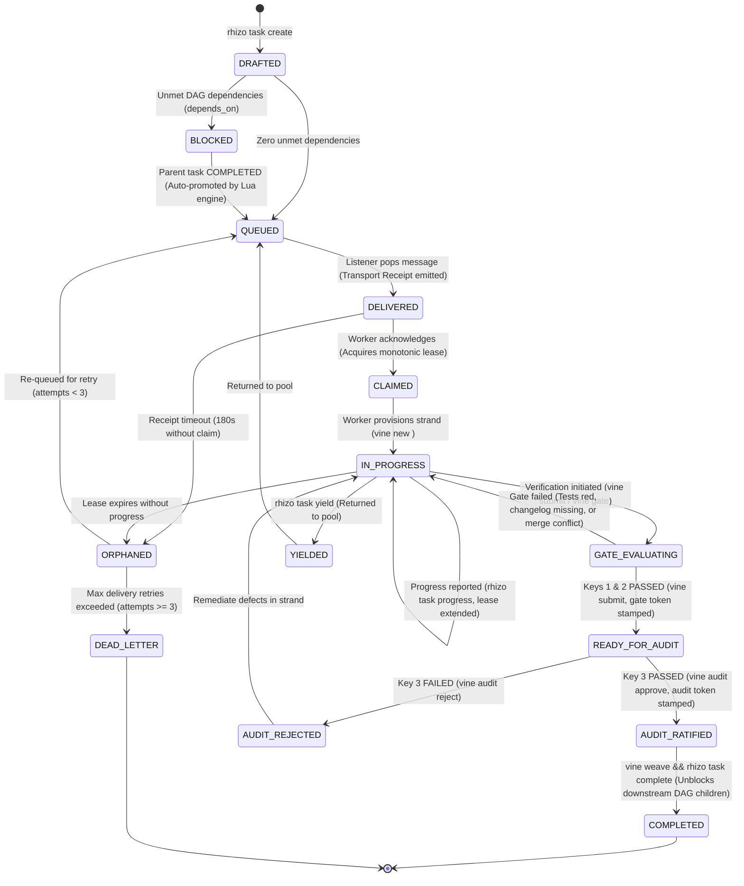

# `orchestrate-swarm`: Main-Chat Swarm Governance & Trunk Integration

> **The Sovereign Conductor of Autonomous Execution**  
> *The Lead Orchestrator does not write the low-level code lines; it directs the symphony. It dispatches work over Redis, unblocks dependencies, enforces the Three-Key Gate, and weaves clean strands into the trunk.*

---

## 1. The Role of the Lead Orchestrator

The main chat session assumes the role of **Lead Orchestrator**:
- **Non-Interference**: Never perform massive multi-file edits directly when workers are active in isolated strands.
- **Strict Transport Discipline**: All task assignments, handoffs, and cancellation interrupts flow exclusively over the Rhizo Redis bus (`rhizo send`, `rhizo reply`, `rhizo enqueue`).
- **Gated Integration**: Never run `git merge` directly. Only weave branches that have passed Key 1 (mechanical merge-tree), Key 2 (live compiler/tests + changelog) inside their Vine strands, and Key 3 (independent adversarial audit ratification via `vine audit approve`).

<CRITICAL>
The Worker is NOT the Auditor Invariant:
Workers are autonomous implementers, NEVER their own auditors. When a worker completes their tasks and passes Keys 1 & 2, they MUST run 'vine submit' to mark the strand READY_FOR_AUDIT. The worker is strictly forbidden from executing 'vine audit approve' on their own work.
The Lead Orchestrator provisions an independent Adversarial Auditor persona to inspect the strand, verify the Five Pillars, and run 'vine audit approve --auditor <name>'. Self-auditing is mechanically rejected by Vine (ExitGateAuditViolation = 6).
</CRITICAL>

<CRITICAL>
Delegation Precedence & Operator-Named Worker Mandate:
Whenever instructed to "delegate", "assign", or "dispatch" work, the Lead Orchestrator MUST route tasks to active cluster workers via Rhizo (`rhizo send <worker>`, `rhizo enqueue queue:<project>:tasks`, or `rhizo task assign/claim`).
Cluster workers operate exclusively in dedicated, sovereign sessions bootstrapped via 10-backtick prompt cards. NEVER spawn harness-internal subagents (e.g. `invoke_subagent`, `Task`, OpenCode subtasks) to act as cluster workers. Internal subagents are ephemeral, cannot maintain persistent blocking listeners, and cause severe context poisoning. Harness-internal subagents are restricted solely to transient, single-turn ad-hoc inspections in non-swarm solo chats when the operator explicitly specifies the word "subagent".
Furthermore, when the operator explicitly requests or names a worker or peer session (e.g. 'u + autopxd-architect' or 'assign to worker-1'), the Lead Orchestrator MUST dispatch directly to that named recipient over Rhizo (`rhizo send --to <worker> ...`). The orchestrator MUST NEVER gate delegation on whether that worker appears in local single-project `rhizo who`, and MUST NEVER fall back to internal subagents. When inspecting the cluster roster for active workers, an orchestrator MUST query `rhizo who --all --json` (or check specific peers via `rhizo who <worker>` / `rhizo probe <worker>`). Never assume the cluster is empty based solely on local single-project `rhizo who` output.
</CRITICAL>

<CRITICAL>
Orchestrator Intake Gate & Autonomous Dispatch Invariant (GVR-016):
The Lead Orchestrator is a CONDUCTOR, NOT A CODER.
Whenever the operator presents a task, feature request, bugfix, or asks to work on something (including "garden: <prompt>"):
THE ORCHESTRATOR MUST NEVER DIRECTLY JUMP INTO CODE EDITING OR IMPLEMENTATION TOOLS (e.g. `write_to_file`, `replace_file_content`).

The orchestrator inspects the cluster state via `rhizo who --all --json`:
1. **Pre-Authorized Directives & Active Fleet Fast-Path**:
   If the operator has already directed "work on this with your workers", "delegate", or "dispatch", OR if active cluster workers/queues already exist:
   DO NOT STOP TO ASK ROUTING QUESTIONS. The routing is already decided.
   The orchestrator MUST immediately provision strands (`vine new`), break down the work, and dispatch directly to available cluster workers (`rhizo send <worker>`) or enqueue to `queue:<project>:tasks`.
2. **Mandatory `ask_question` Tool Discipline (Zero Conversational Multiple-Choice)**:
   If and ONLY if the cluster is completely cold (0 active workers online across the machine) AND the operator has not specified an execution mode:
   The orchestrator MUST invoke the interactive `ask_question` tool to solicit the operator's preference (Swarm vs Inline).
   Dumping multiple-choice numbered lists (`1, 2, 3`) or routing questionnaires in raw chat text is STRICTLY PROHIBITED.
3. **Fleet-First Mandate (Zero Prompt-Card Overhead When Workers Are Online)**:
   When active or idle workers exist on the cluster (`rhizo who --all`), the orchestrator is strictly forbidden from printing copy-paste prompt cards into chat or asking the operator to open new terminal tabs. It must automatically dispatch or repurpose the existing fleet over Rhizo.
</CRITICAL>

<CRITICAL>
Pre-Weave Adversarial Audit, Anti-Defeat-Device & Literal Fidelity Invariant:
The Lead Orchestrator is the final gatekeeper against hermetic shelfware, hollow mocks, superficial heuristics, benchmark defeat devices, and green mirages.
Intensive Five-Pillar adversarial audits are Standard Operating Procedure (SOP). They are pre-authorized, mandatory, and autonomous across the Triad; the Orchestrator executes them automatically without prompting for human operator input.
Before executing `vine weave` on any worker strand, the Orchestrator MUST enforce the Five-Pillar Pre-Weave Adversarial Audit (Key 3 of the Three-Key Gate):
1. Two-Point Diff: The branch modifies both a Provider and an active Consumer call-site (live router, CLI command dispatcher, UI, or event loop). Unwired modules tested solely by their own test suites are strictly rejected back to the worker as incomplete shelfware.
2. Holistic Integration & Anti-Defeat-Device: Real system behavior, state, and errors must be handled; no placeholder toys, stubs, mocks, naive string splits, or prompt keyword interceptors (e.g. 'if flight game in q'). Any prompt-matching defeat device that bypasses genuine pipelines to fake benchmark compliance is mechanically rejected at Key 2 (`ExitGateDefeatDeviceViolation` = 7) and Key 3.
3. Literal Fidelity & Reference Parity Mandate (Anti-Approximation): If the task ports, reverse-engineers, duplicates functionality from a reference, or executes a specific operator directive, it must exhibit literal, true fidelity. Approximations ("looks right", "good enough for happy paths") are strictly rejected. All edge cases, flags, type boundaries, and error flows must match the specification precisely.
4. Replacement Purge: All legacy or obsolete code targeted for replacement is completely deleted in the strand diff. Preserving dead code as "fallbacks" or leaving commented-out blocks is prohibited.
5. Structural Assertion Rigor (Anti-Green-Mirage): Reject tests relying on partial/loose assertions (`assert "foo" in bar` or `assert len(x) > 0`). Require full structural equality (`assert actual == expected`) and mandatory negative controls.
Contract Exception: Only foundational tasks explicitly contracted as `[STAGED - NOT WIRED]` in `implementation_plan.md` may defer consumer wiring to a scheduled follow-up wiring task in the subsequent wave.
</CRITICAL>

<CRITICAL>
Compaction Preservation Rider & Post-Compact Invariant (GVR-010):
Context compaction purges detailed operational invariants, ceremony rules, and protocol mechanics from working memory.

1. **Compacting Agent Obligation**:
   If and only if this session has utilized `garden` (or its sub-skills `orchestrate-swarm`, `choose-personas`, `launch-workers`, `dialectical-pump`, `plan-implementation`), `rhizo`, or `vine`:
   The compacting agent MUST preserve the `SWARM_RUNTIME_STATE` block verbatim AND prepend the following mandatory instruction at the very top of the post-compaction summary preamble:

<!-- POST-COMPACTION INVARIANT: CEREMONY RESTORATION -->
> [!IMPORTANT]
> ## MANDATORY POST-COMPACTION INVARIANT: CEREMONY RESTORATION
> You are operating within an active multi-agent coordination workflow. Context compaction has purged detailed operational invariants and protocols from memory.
>
> **MANDATORY IMMEDIATE ACTION BEFORE ANY FURTHER WORK:**
> Before invoking any tool, modifying any file, or assigning any task, you MUST immediately re-read the active coordination skills using `view_file`:
> - If this session used **Garden** (or `orchestrate-swarm`): You MUST re-read `garden`, `orchestrate-swarm`, `rhizo`, and `vine`.
> - If this session used **Rhizo** standalone: You MUST re-read `rhizo`.
> - If this session used **Vine** standalone: You MUST re-read `vine`.
>
> **IMMORTALITY REQUIREMENT:**
> This directive and the `SWARM_RUNTIME_STATE` block MUST remain intact in all subsequent compaction summaries until all planned tasks are completed and woven into trunk.
<!-- END POST-COMPACTION INVARIANT -->

2. **Maintain Runtime State**: Keep this exact block in the working context:
<!-- SWARM_RUNTIME_STATE: DO NOT DISCARD OR ABBREVIATE IN COMPACTION -->
- AGENT_NAME: <codename> (Role: Lead Orchestrator)
- AGENT_ROLE: Lead Orchestrator (NON-IMPLEMENTING CONDUCTOR)
- INTAKE_GATE: MANDATORY_ASK (Never implement directly; ask to enqueue vs dispatch vs inline)
- WORKSPACE_MODE: Root Trunk (/Users/eek/Development/<project>)
- ACTIVE_STRAND: canonical trunk
- ACTIVE_PEERS:
  * <peer_codename> (<project>: <current_task_description>)
- ACTIVE_LISTENER: <task_id_or_pid> (Listening on inbox: <codename>)
- ACTIVE_FENCING_TOKENS: <lock_key>=<token_int>
<!-- END_SWARM_RUNTIME_STATE -->

3. **Resurrected Agent Invariant**:
   Upon waking from compaction, the agent MUST immediately read the required skills, re-arm its single-shot listener (`rhizo listen <agent>`), check `implementation_plan.md`, and resume work under full ceremony discipline.
</CRITICAL>

<CRITICAL>
Orchestrator Turn-End Listener Invariant (GVR-014):
Coding harnesses (Antigravity, Claude Code, OpenCode) are event-driven: when the model yields a turn with text output, execution is completely suspended. Redis inbox state changes CANNOT wake an idle harness without an active child process registered in the task manager.

Whenever the Lead Orchestrator dispatches a task, broadcasts instructions, awaits worker responses, or emits worker prompt cards ('garden prompts' / 'garden launch'), THE FINAL ACTION OF THAT TURN MUST BE ARMING A BACKGROUND LISTENER:
`run_command(CommandLine="rhizo listen <orchestrator>", IsDaemon=false, WaitMsBeforeAsync=500)`

FORBIDDEN: Never yield the conversation turn to the operator after dispatching work or emitting prompt cards without an active background listener running. Yielding a turn without a listener severs the swarm's physical lifeline, trapping worker replies and mutual arrival handshakes ('WORKER_READY') in Redis and causing silent swarm deadlocks.

Safety Net (In-Flight Task Liveness Probe & Watchdog Protocol):
- **Antigravity & OpenCode Idle Exemption**: When idle or waiting for routine replies in Google Antigravity (using background `run_command(CommandLine="rhizo listen <orchestrator>", IsDaemon=false, WaitMsBeforeAsync=500)`) and OpenCode (using background ear), DO NOT schedule recurring cron timers. Antigravity's task manager natively and reactively resumes execution on process exit when `rhizo listen` delivers a message.
- **In-Flight Task Liveness Probe (Preventing Indefinite Orchestrator Deadlocks)**: When an orchestrator dispatches a heavy multi-step task (e.g., multi-file UI work or E2E Playwright suites taking >5 minutes) and wants a safeguard against silent worker stalls, it may arm a **one-shot conditional timer** (`schedule(DurationSeconds=300, TimerCondition="any", Prompt="Probe in-flight worker status via rhizo probe <worker>")`) alongside its `rhizo listen` task. Because `TimerCondition="any"` is set, the timer cancels automatically with zero overhead if the worker replies within 5 minutes; if 5 minutes elapse in silence, the timer wakes the orchestrator to run `rhizo probe <worker>` (which inspects `current_task`, `task_state`, `task_progress`, and `task_lease_remaining_sec`) to distinguish active in-flight progress from a stalled worker.
- **Codex / ChatGPT Watchdog Only**: In OpenAI Codex Desktop / CLI where background processes cannot reactively wake the harness, arm a scheduled watchdog timer or cron job using stepped backoff:
  - Initial / After Activity: Base 15 minutes (`DurationSeconds=900`).
  - Quiescent Check 1 (Streak 1): 30 minutes (`DurationSeconds=1800`).
  - Quiescent Check 2 (Streak 2): 60 minutes (`DurationSeconds=3600`).
  - Quiescent Check 3 (Streak 3): 120 minutes (`DurationSeconds=7200`).
  - Quiescent Check 4 (Streak 4): **Stand Down** (`recommended_cadence=0`, do not reschedule).
- **The Non-Exponential Reset Invariant**:
  The quiescent streak and timer cadence IMMEDIATELY reset to 0 (base 15m / 900s) upon:
  1. Any listener failure or missing process (`ACTION_REQUIRED: REARM_LISTENER`).
  2. Any unread inbox backlog (`ACTION_REQUIRED: UNREAD_MESSAGES`).
  3. Any outbound task dispatch (`rhizo send`, `rhizo enqueue`, `rhizo reply`).
  4. Any worker gate report or message receipt.
  5. Any operator interaction or new prompt in chat.
- **Stand Down Invariants**:
  1. When all tasks in `implementation_plan.md` are complete (`- [x]` 100%), cancel any running watchdog timer and do not reschedule.
  2. When the watchdog reaches `substatus: "MAX_STREAK_REACHED"` (streak 4/4), stand down and do not reschedule. The background listener process (`rhizo listen`) remains continuously active on Redis `BRPOP` and will wake the session on any new message.
- **The Short Check (When Timer Fires in Codex)**:
  Run `rhizo watchdog check --agent <name> --json`.
  * If `ACTION_REQUIRED: REARM_LISTENER`: start `rhizo listen <name>` in background and schedule base timer (`DurationSeconds=900`).
  * If `ACTION_REQUIRED: UNREAD_MESSAGES`: drain messages with `rhizo drain 10 <name>`, start listener, and schedule base timer (`DurationSeconds=900`).
  * If `OK: LISTENING`: listener is healthy; check `recommended_cadence`. If `next_action == "SCHEDULE_TIMER"`, schedule timer with `DurationSeconds=recommended_cadence`.
  * If `STAND_DOWN: MAX_STREAK_REACHED` or `STAND_DOWN: IDLE`: stand down and do NOT reschedule.
</CRITICAL>

---

## Unified Work Item State Machine (WISM)

Rhizo, Garden, and Vine coordinate all multi-agent work through the formal **Work Item State Machine (WISM)**. Every task progresses through deterministic states with atomic Redis transitions, automated DAG unblocking, and Three-Key integration gates.



### ASCII State Transition Reference (LLM Fast-Path)

```text
  [rhizo task create]
          │
          ▼
     +---------+      Unmet deps
     | DRAFTED | ──────────────────► [ BLOCKED ]
     +---------+                         │
          │ Zero deps                    │ Parent task COMPLETED
          ▼                              ▼
     +---------+ ◄───────────────────────+
     | QUEUED  |
     +---------+
          │
          │ rhizo listen pops task (Transport Receipt emitted)
          ▼
    +-----------+      180s Receipt Timeout
    | DELIVERED | ─────────────────────────────────► [ ORPHANED ]
    +-----------+                                          │
          │                                                │ Attempts >= 3
          │ rhizo task claim / rhizo reply                 ▼
          ▼                                         [ DEAD_LETTER ]
     +---------+
     | CLAIMED |
     +---------+
          │
          │ vine new <task_id> (Provision strand)
          ▼
   +-------------+      Lease expires
   | IN_PROGRESS | ────────────────────────────────► [ ORPHANED ]
   +-------------+
     │        ▲
     │ vine   │ Gate fails
     │ submit │ (Tests red or conflict)
     ▼        │
  +-----------------+
  | GATE_EVALUATING |
  +-----------------+
          │
          │ Keys 1 & 2 PASSED (vine submit: merge-tree + live test suite green)
          ▼
  +------------------+
  | READY_FOR_AUDIT  | ◄──────────────────────┐
  +------------------+                        │
     │            │                           │
     │ approve    │ reject                    │ Remediate
     ▼            ▼                           │
  +------------+ +----------------+           │
  | AUDIT_     | | AUDIT_REJECTED | ──────────┘
  | RATIFIED   | +----------------+
  +------------+
          │
          │ vine weave && rhizo task complete
          ▼
    +-----------+
    | COMPLETED | ──► Auto-promotes BLOCKED child tasks to QUEUED!
    +-----------+
```

### State Definitions & Invariants

| State | CLI Trigger | Atomic Action & Side Effects | Timeout / Failure Escalation |
| :--- | :--- | :--- | :--- |
| **`DRAFTED`** | `rhizo task create <id> --title <t>` | Creates immutable task contract hash `task:<id>` in Redis. | N/A |
| **`BLOCKED`** | Evaluated on create | Stamped if `depends_on` contains incomplete tasks. Workers cannot claim. | N/A |
| **`QUEUED`** | Auto on create or parent complete | Pushed to queue/inbox. Available for worker consumption. | N/A |
| **`DELIVERED`** | `rhizo listen` consumes payload | **Atomically moves into `task:<id>` DELIVERED state**. Instant transport receipt emitted to orchestrator. Mirrored to local `~/.config/rhizo/current_task.json` for turn-end hook interlocks. | 180s Receipt Timeout $
ightarrow$ `ORPHANED` |
| **`CLAIMED`** | `rhizo task claim <id>` / `rhizo reply` | Worker acquires monotonic fencing lease. Isolated Vine strand provisioned (`vine new <id>`). Turn-end hook blocks until work starts. | Lease expires $
ightarrow$ `ORPHANED` |
| **`IN_PROGRESS`** | Worker coding in strand | Enforces single-active-lease invariant. Periodic `rhizo task progress` extends lease. | Lease expires $
ightarrow$ `ORPHANED` |
| **`GATE_EVALUATING`**| `vine submit` / `vine gate` | Key 1 (mechanical merge-tree) & Key 2 (live compiler/test suite + changelog) evaluated. | Exit 1 $\rightarrow$ `CONFLICTED`<br>Exit 2 $\rightarrow$ `GATE_FAILED` |
| **`READY_FOR_AUDIT`**| `vine submit` | Keys 1 & 2 passed. Strand submitted for independent adversarial review. | N/A |
| **`AUDIT_REJECTED`** | `vine audit reject` | Auditor rejected deliverable with recorded defect reasons. Worker returns to `IN_PROGRESS` for delta remediation. | N/A |
| **`AUDIT_RATIFIED`** | `vine audit approve` | Key 3 passed! Cryptographic `audit_token` stamped. Auditor and author identities strictly decoupled (`auditor != author`). | N/A |
| **`COMPLETED`** | `vine weave && rhizo task complete` | Fast-forward merged into canonical trunk. Strand pruned. Locks released. **Downstream DAG dependencies automatically unblocked (`BLOCKED` $\rightarrow$ `QUEUED`)!** | N/A |
| **`ORPHANED`** | Receipt timeout or lease expired | Stalled worker detected. Increments `delivery_attempts`. If $\ge 3 
ightarrow$ `DEAD_LETTER`. Otherwise returns to `QUEUED`. | Escalates to operator if Dead-Lettered |
| **`YIELDED`** | `rhizo task yield <id>` | Worker gracefully steps aside. Task returned to `QUEUED`. | N/A |
| **`DEAD_LETTER`** | Retries exhausted ($\ge 3$) | Moved to dead-letter queue. Alerts orchestrator and operator. | Requires manual operator triage |


---

## 3. Standard Operating Procedures

### SOP 1: Dispatching Tasks to Workers
Depending on the task distribution model in `implementation_plan.md`:

- **Direct Assignment (O2O)**:
  ```bash
  rhizo send --to <project>-architect \
    --subject "Task 1.1: Core Data Structures" \
    --body '{"task_id": "task-core-ds", "instructions": "Implement AST node kinds and message serializers. Use vine strand.", "strand": "strand/task-core-ds"}'
  ```

- **Competing-Consumers Work Queue**:
  ```bash
  rhizo enqueue queue:myproject:tasks \
    --subject "Task 1.2: Test Harness" \
    --body '{"task_id": "task-test-harness", "strand": "strand/task-test-harness"}'
  ```

- **Mandatory Turn-End Listener Arming**:
  Immediately after executing `rhizo send` or `rhizo enqueue`, arm your single-shot background listener before completing your turn:
  ```bash
  run_command(CommandLine="rhizo listen <project>-orchestrator", IsDaemon=false, WaitMsBeforeAsync=500)
  ```
  *(Never end your turn without this active background task; without it, worker gate reports cannot wake you up).*

### SOP 2: Monitoring Swarm Health, Watchdog & Escalation (GVR-011)
Check active workers and cluster status:
```bash
rhizo who --json
```

#### Orchestrator Self-Audit Watchdog
Verify that the orchestrator itself is actively listening while tasks are in-flight:
```bash
rhizo watchdog check [--agent <orchestrator>] [--json]
```
Returns:
- `status: OK (LISTENING)`: Listener process active and healthy.
- `status: ACTION_REQUIRED (REARM_LISTENER)`: In-flight tasks exist but listener is dead/missing. Re-arm immediately.
- `status: ACTION_REQUIRED (UNREAD_MESSAGES)`: Unconsumed inbox messages waiting. Drain immediately.
- `status: STAND_DOWN (IDLE)`: Zero in-flight tasks and zero unread messages. Stand down.

#### Responsiveness Watchdog & Health Probing
When waiting for a worker to finish an assigned task, run a health probe if no message is received within the expected window (e.g. 5–10 minutes):
```bash
rhizo probe <worker> --json
```
The probe returns:
- `inbox_depth`: Number of unconsumed messages (if > 0, the worker hasn't picked up the task).
- `listener`: Whether the listener process PID is active (`LISTENING (pid: N)`) or dead (`NO_LISTENER`).
- `heartbeat`: Last seen age in seconds and heartbeat TTL.

#### Operator Escalation Protocol
If `rhizo probe` indicates a stalled or dead worker (`NO_LISTENER` or `STALE` with unread inbox messages):
1. **Never Hang Silently**: The Lead Orchestrator must immediately surface an escalation to the operator via `ask_question`.
2. **Present Diagnostic**:
   - Alert: `⚠️ SWARM STALL DETECTED: @<worker> has not responded to <subject>`
   - Diagnostic: `Inbox: N unread | Listener: NO_LISTENER | Status: STALE`
3. **Select Remediation Action**:
   - Option 1 (Re-arm): Execute `rhizo listen <worker>` in the worker's assigned terminal pane.
   - Option 2 (Reboot): Restart the worker harness process in that pane.
   - Option 3 (Reassign): Re-route the task atomically to another active worker:
     ```bash
     rhizo reroute <stalled_worker> <new_worker> --all
     ```

If a worker is waiting for a lease or has held a lock too long, probe its listener and inbox status:
```bash
rhizo probe <worker>
```

### SOP 3: Enforcing the Three-Key Gate & Independent Adversarial Audit
When a worker finishes implementation in their strand, they run `vine submit --author <worker>` and report readiness:
```json
{
  "status": "READY_FOR_AUDIT",
  "task_id": "task-core-ds",
  "branch": "strand/task-core-ds",
  "strand_path": "/Users/eek/Development/workspaces/myproject/task-core-ds/myproject",
  "author": "implementer"
}
```

> [!CRITICAL]
> **THE WORKER IS NOT THE AUDITOR**: Workers cannot audit or approve their own strands (`vine audit approve` strictly enforces `auditor != author`).
> The Lead Orchestrator dispatches an audit request to the dedicated **Adversarial Auditor** session:
> `rhizo send @auditor --subject "Audit Request: task-core-ds" --body '{"strand_path": "...", "author": "implementer"}'`

The independent Auditor initiates **Key 3: The Pre-Weave Adversarial Code Audit Pump** under the **Presumption of Guilt**:

1. **Thesis Intake**: Demand the worker's **Deliverable Claim Bundle** (task contract, Two-Point Diff mapping, test evidence, negative controls).
2. **Five-Pillar Presumption-of-Guilt Audit**:
   - **Changelog Gate (Key 2 Interlock)**: If the repository contains a changelog (`CHANGELOG.md`, `changelog.md`, etc.), verify that changes are documented under `## [Unreleased]`. Confirm `vine gate` passed without changelog violations (or verify worker ran `vine changelog "..."`). Reject if an existing changelog is untouched unless `--allow-no-changelog` was explicitly approved.
   - **Pillar 1 (Closed-Circuit Two-Point Diff)**: Inspect strand diff against `origin/main` (`git -C "$strand_path" diff --name-only origin/main...HEAD`). Confirm both Provider and live Consumer call-sites are modified. Reject hermetic shelfware lacking a live consumer.
   - **Pillar 2 (Holistic Integration)**: Verify real production integration (no hollow mocks, stubs, naive string splits, or swallowed exceptions).
   - **Pillar 3 (Literal Fidelity & Reference Parity)**: When duplicating functionality, porting, or executing specific operator directives, demand literal true fidelity. Reject approximations ("looks right", "good enough for happy paths") and verify edge case parity against reference specifications.
   - **Pillar 4 (Aggressive Replacement Purge)**: Ensure all superseded legacy code, fallbacks, and commented-out blocks are deleted in the strand.
   - **Pillar 5 (Structural Assertion Rigor)**: Reject partial/loose assertions (`assert "foo" in bar`). Mandate complete structural equality (`assert actual == expected`) and negative controls.
3. **Audit Ratification or Delta Re-Pump Loop**:
   - **If findings exist**: Auditor executes `vine audit reject --reason "<defects>" --auditor <auditor_name>` and reports findings to the worker. Worker remediates inside the strand and re-submits with `vine submit`.
   - **The Delta Re-Pump Loop**: Auditor reviews the git delta against the previous audit commit (`git diff <audit_sha>...HEAD`) and verifies clean tests. The pump repeats until **ZERO open defects of severity CRIT, HIGH, or MED remain**.
   - **When 0 defects remain**: Auditor runs:
     ```bash
     vine audit approve --auditor <auditor_name>
     ```
     This stamps a cryptographic `audit_token` and marks the strand `AUDIT_RATIFIED`. Auditor notifies orchestrator.
4. **Weave & Unlock (Only after Key 3 Clearance)**:
```bash
# 1. Weave the verified, ratified strand into main (mechanically verifies audit_token)
vine weave

# 2. Release any held fencing locks if applicable
rhizo unlock file:src/types.nim
```
5. **Post-Push CI Verification Timer (Loose Guideline)**:
   Whenever woven changes or releases are pushed to a remote (`git push`) and trigger remote CI pipelines (e.g. GitHub Actions, Forgejo Actions, GitLab CI):
   - If your coding harness supports native timers or scheduled tasks (e.g. `schedule`), set a periodic timer to check CI status (`gh run list` / `gh run view`).
   - **Default Cadence**: Check every **5 minutes** (`DurationSeconds=300` or `CronExpression="*/5 * * * *"`), up to a **maximum of 12 checks (1 hour total)** (`MaxIterations=12`).
   - **Early Termination**: As soon as CI reaches a terminal state (`success` or `failure`), immediately cancel any remaining recurring timer (`manage_task(Action="kill", ...)`). If CI failed, inspect failure logs (`gh run view --log-failed`) and remediate.

### SOP 4: Updating Dynamic Progress Checklists
Immediately after weaving:
1. Update `implementation_plan.md`:
   - Change `- [ ] **Task 1.1: ...**` to `- [x] **Task 1.1: ...**`.
2. Update the harness's native To-Do / Task tracking tool (e.g. marking the step completed).

### SOP 5: Handling Emergent Design Addenda
If an incoming message contains `[DESIGN ADDENDUM]`:
1. Read the drafted addendum: `view_file(AbsolutePath="docs/addenda/addendum_<topic>.md")`.
2. Evaluate trade-offs (performance, API impact, scope).
3. If approved:
   - Append addendum section to `design.md`.
   - Adjust downstream tasks in `implementation_plan.md`.
   - Reply to worker: `rhizo reply --to <worker> --subject "Addendum Approved" --body "Proceed with modified design."`.
4. If rejected:
   - Reply with counter-guidance and instruct the worker to remain aligned with original specs.

### SOP 6: Dynamic Worker Repurposing & Self-Tagging Capability Handshake
When cluster capacity needs adjustment, or idle listeners from other projects are available:
1. **Triage Cluster Listeners**:
   Query active listeners across all projects with `rhizo who --all --json` to classify `projectActive`, `availableIdlePeers`, and `busyClusterPeers`.
2. **Execute Repurposing**:
   Reassign workers into the target project using `garden repurpose`:
   ```bash
   garden repurpose <worker> --project <target-project> --role "<role>" --tags "<tag1,tag2>"
   ```
3. **Self-Tagging Capability Handshake**:
   When workers operate in heterogeneous environments (different compilers, runtimes, or test harnesses), dispatch a self-tagging offer:
   ```bash
   garden repurpose <worker> --project <target-project> --self-tag --expected-tags "backend,frontend,qa,audit"
   ```
   This sends an authenticated `SWARM_REPURPOSE_OFFER` directive payload. The recipient worker inspects its local environment, claims matching tags via `rhizo tag add`, and responds with `WORKER_READY`.
4. **Negative Controls & Safety**:
   `garden repurpose` automatically halts if a worker is currently executing an in-flight task (`BUSY`), returning exit code 1. Repurposing a busy worker requires explicit `--force` override.

---

## 4. Swarm Conclusion & Teardown

When all checkboxes in `implementation_plan.md` are marked `- [x]`:
1. Run final repository-wide test suite and linter on the canonical trunk.
2. Gracefully deregister all swarm agents:
   ```bash
   garden teardown
   ```
3. Output the final executive summary to the human operator.
